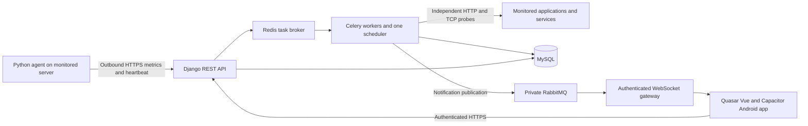

# Cronos — Server and Application Monitoring

Specification draft · 19 October 2026

## 1. Confirmed scope

Build an application for Android phones and tablets using Quasar Vue, Django, and MySQL. Monitor server health and application status. Notify users when server health is strictly below 50% or the server becomes unreachable. This delivery is a specification only; no application has been implemented or deployed.

All intervals, weights, retention periods, and escalation rules below are proposed defaults, configurable during implementation. Linux servers are the initial target assumption; Windows support is outside the first release.

## 2. Architecture

- Frontend: Quasar Vue with TypeScript, Pinia, Vue Router, and Capacitor for Android packaging. Responsive phone and tablet layouts share one codebase.
- API: Django and Django REST Framework. Select supported framework/runtime versions and pin them at implementation kickoff.
- Database: MySQL using Django's MySQL backend, transactional tables, utf8mb4, and UTC timestamps. Display dates in the user's configured timezone, initially Asia/Manila.
- Background execution: Celery workers and a single Celery Beat scheduler; Redis is the broker/cache, while MySQL remains the persistent database.
- Collection: a lightweight Python agent running as a systemd service, using psutil and narrowly permitted adapters for local services.
- Notifications: persistent in-app notifications plus RabbitMQ and an authenticated WebSocket gateway. Android uses a native foreground service for background/locked-screen alarms; browsers require the page to remain open.
- Deploy the monitoring backend outside the failure domain of the monitored servers. An external watchdog checks Cronos itself.
- The phone does not run monitoring probes. Checks and alerts continue when the Android application is closed.

## 3. Monitoring coverage

| Area | Measurements or checks | Delivery phase |
|---|---|---|
| Availability | Heartbeat age, independent TCP/HTTPS probes, probe location | MVP |
| CPU | Usage, load per logical core, sustained saturation | MVP |
| Memory | Available RAM, used percentage, swap; OOM events through an adapter | MVP; OOM adapter later |
| Storage | Used space and inode percentage per selected filesystem, disk I/O counters | MVP |
| Network | Interface byte counters, computed rates, interface errors, probe latency | MVP |
| Services | Configured systemd service state and restart counts | MVP |
| Applications | HTTPS reachability, response time, expected status, optional health JSON assertion | MVP |
| Database | Optional local connection check, connection count, size, slow queries, locks, replication lag | Basic service state in MVP; detailed adapter later |
| Background jobs | Worker heartbeat, pending/failed jobs, oldest job age | Adapter phase |
| Scheduled tasks | Job completion heartbeat, expected schedule, missed/failed runs | Adapter phase |
| Logs | Structured error counts, authentication failures, selected error events | Adapter phase |
| Security | Pending security updates, unexpected account/configuration changes | Adapter phase |
| TLS | Expiry date, days remaining, validation/renewal failures | MVP |
| DNS/domain | Expected DNS resolution; domain expiry where supported by a verified source | DNS in MVP; domain expiry later |
| Backups | Last success, maximum age, failure, destination capacity, last verified restore | Adapter phase |
| Clock | NTP synchronization and offset when available | Adapter phase |
| Trends | Historical charts, storage growth, capacity trend | MVP charts; forecasting later |
| Monitoring | Agent freshness, scheduler heartbeat, queue lag, notification delivery failures | MVP |

Each unavailable or unconfigured adapter displays “Not configured” or “Unknown,” never a healthy checkmark. Counters require two samples before rates can be calculated. Exclude virtual filesystems and explicitly select relevant disks/interfaces.

## 4. Health score

Reachability, data freshness, server health, and application health are separate fields. A 100% CPU reading is utilization, not a 100% health score.

Proposed resource score, calculated only from fresh server telemetry:

| Component | Weight | Good boundary | Critical boundary |
|---|---:|---:|---:|
| CPU utilization | 25% | At or below 60% | At or above 95% |
| RAM utilization | 25% | At or below 70% | At or above 95% |
| Filesystem space used | 25% | At or below 75% | At or above 95% |
| Filesystem inodes used | 10% | At or below 75% | At or above 95% |
| Required local services | 15% | All required services running | All required services stopped |

For each utilization metric x, its component health is 100 at/below the good boundary, 0 at/above the critical boundary, and `100 × (critical − x) / (critical − good)` between the boundaries. For disk space and inodes use the worst selected filesystem. Required-services health is `100 × running required services / total required services`.

Overall score = sum of component health × component weight / sum of applicable weights. Round only for display; alert against the unrounded score. Deliberately disabled components are excluded and remaining weights normalized. Unexpectedly missing required components make overall health Unknown; show partial values separately and raise a data-quality incident. A new server remains Pending until its first valid report.

Examples: all components healthy = 100%; CPU and RAM critical with all other components healthy = 50% (no below-50 alert); additional degradation makes the score less than 50% and qualifies after the persistence window.

Display states: Healthy 80–100%; Warning 50–less than 80%; Critical below 50%; Unknown when required data is unavailable. Unreachable is a separate availability state and does not fabricate a 0% resource score. Preserve the last score with its timestamp and mark it stale.

A required service failure, application outage, disk above 95%, backup failure, or TLS failure generates its own incident even if the aggregate server score remains above 50%. Application health is not averaged into server resource health, so a healthy host cannot conceal a failed application.

## 5. Collection and outage detection

- Agent posts metrics every 30 seconds. Mark telemetry stale after 90 seconds without a valid report; open an Agent offline incident.
- Independently probe a configured TCP or HTTPS target every 30 seconds with a five-second timeout and at most one concurrent run per target. ICMP is optional and never the sole reachability test.
- Three consecutive probe failures open a Server unreachable incident (target approximately 90 seconds plus probe/scheduler delay).
- If telemetry is stale but probes succeed, report Agent offline, with server externally reachable.
- If probes fail but telemetry is fresh, report External endpoint unreachable, with server agent reporting. Do not claim the entire host is down.
- If telemetry is stale and probes fail, report Server unreachable from the monitoring location. This is evidence of failure from that location, not proof of power loss.
- Without an independent configured probe, missing telemetry means Availability unknown and Agent offline, not a confirmed host outage.
- Record scheduled, observed, and received times. Detect scheduler backlog and clock skew; reject replayed or excessively old telemetry.

## 6. Application monitoring

Each application belongs to a server and has a name, environment, URL, check interval, timeout, expected HTTP status, optional JSON key/value assertion, latency threshold, and enabled flag. HTTP 200 alone does not prove a dependency is healthy; a readiness endpoint can expose database/cache/queue status without secrets.

States: Pending, Healthy, Degraded, Down, Unknown, and Maintenance. Three consecutive failed checks mark Down. Three consecutive successful but slow checks mark Degraded; default latency threshold 2,000 ms. Two consecutive successful checks below the latency threshold recover to Healthy. Preserve failure reason: DNS, timeout, connection refused, TLS validation, unexpected status, or failed assertion. Timeout counts as failure, not a numeric zero latency.

Check application URLs from the monitoring worker independently of the host agent. Local service checks and public application checks remain distinct. Preserve TLS validation. Redirects are disabled by default; if enabled, validate every redirect destination. Private monitoring destinations require explicitly authorized network ranges and isolated probe access. Never permit access to cloud metadata or the monitoring platform's administrative endpoints through user-supplied URLs.

## 7. Incidents and notification rules

| Trigger | Proposed rule | Action |
|---|---|---|
| Low server health | Unrounded score below 50 for three consecutive fresh samples | Critical incident and push |
| Server unreachable | Three consecutive independent probe failures | Critical availability incident and push |
| Agent offline | No valid heartbeat for 90 seconds | Data collection incident and push |
| Application Down | Three consecutive failed checks | Critical application incident and push |
| Application Degraded | Three consecutive slow successful checks | Warning incident and push |
| Required service stopped | Two consecutive stopped observations | Critical service incident and push |
| TLS expiry | Crossing 30, 14, 7, and 1 day remaining | Warning/escalation notification |
| Recovery | Health at least 60 for three samples; availability/application two successful probes | Resolve automatically and notify |

Deduplicate by target and rule: one open incident per key, enforced transactionally. Repeat failures update the incident rather than create new ones. Default reminders every 30 minutes while unresolved; acknowledgement stops reminders but does not resolve the incident. Escalations and recovery messages still deliver. Health between 50 and 60 leaves an existing low-health incident open to prevent flapping; explain this recovery threshold in settings.

When a server outage explains child application failures, retain child incident evidence and suppress duplicate child push alerts. An application failure while the server remains reachable still sends its own alert. Evaluate targets in batches so parent/child correlation is deterministic.

Maintenance windows suppress pushes/reminders while continuing collection and showing Maintenance. At window end, notify about active failures. No recovery push for an incident that was never notified. Notifications link to the target and incident. Record delivery attempts separately from incident creation, retry transient errors with backoff, invalidate rejected device tokens, and retain failures for review.

Live delivery requires a connected gateway client. Android maintains its socket in a native foreground monitoring service, including in background/locked-screen operation; force-stop, reboot, network loss, deep Doze, and vendor battery restrictions can interrupt delivery. Connectivity, device state, and OS restrictions can delay or prevent display. Provider acceptance is not proof the user received/read the alert. The in-app incident history is authoritative. Support a test-notification action and connection status screen. Push payloads carry an incident ID and minimal text, excluding credentials and sensitive logs.

## 8. Screens and navigation

Phone bottom navigation: Overview, Servers, Applications, Alerts. Settings and account are accessible from the toolbar. Tablets use a persistent navigation rail and master/detail layouts.

1. Sign in: authentication, session expiration, connection errors.
2. Overview: server/application counts by state, active incidents, last refresh time, and clearly identified stale data. Prioritize critical incidents.
3. Servers: searchable/filterable list with name, environment, availability, health score, heartbeat age, and incident count.
4. Server detail: health breakdown, reachability evidence, CPU/RAM/disk charts, selected services, applications, and incident timeline. Chart windows: 1 hour, 24 hours, 7 days.
5. Add/edit server: identity, environment, agent enrollment, required services, filesystems, independent probe, maintenance, and notification recipients. Show enrollment secret once.
6. Applications: searchable list; detail shows status, response-time chart, uptime window, latest checks, TLS, dependencies, and incidents.
7. Alerts: open/acknowledged/resolved filters; details include trigger evidence, timestamps, deliveries, acknowledge, and comments. Resolution is automatic on verified recovery; manual closure records a reason and does not suppress a still-failing rule.
8. Settings: thresholds, recipients, device registration, push permission/test, timezone, maintenance, roles, and retention.

All screens support loading, empty, error, unauthorized, offline, and stale states. Cache only limited previously fetched data; label it with last-sync time. Do not acknowledge or edit incidents optimistically while offline. Poll visible dashboard data every 30 seconds initially; resume refresh on app foreground.

## 9. Persistent data model

| Entity | Main fields |
|---|---|
| User / Membership | Identity, role, authorized server/group scope |
| Server / ServerGroup | Name, hostname, environment, OS, timezone, enabled, owner/group |
| AgentCredential | Server, token hash, created/rotated/revoked timestamps |
| MetricSample | Server, sampled/received times, CPU, RAM, swap, load, schema version |
| FilesystemSample / NetworkSample | Sample FK, mount/interface, capacity/inodes/counters/rates |
| Service / ServiceObservation | Server, configured service, required flag, state, observed time |
| Probe / ProbeResult | Target, method, interval, expected result, outcome, latency, error, time |
| Application | Server, name, URL, environment, health assertion, thresholds, enabled |
| AlertRule | Target/group scope, metric, threshold, persistence, recovery, severity |
| Incident / IncidentEvent | Target, rule, deduplication key, state, severity, evidence, timeline |
| DeviceRegistration | User, encrypted provider token, platform, last seen, revoked time |
| Notification / DeliveryAttempt | Incident, recipient, channel, read time, provider result, retry time |
| MaintenanceWindow | Targets, start/end, reason, creator |
| JobHeartbeat / BackupObservation | Optional adapter identity, expected interval, last result |
| AuditEvent | Actor, action, target, timestamp, sanitized change metadata |

Index time-series tables on `(server_id, sampled_at)` or `(probe_id, checked_at)`. Use a transactional unique open-incident key to prevent concurrent duplicates. Store current summaries separately from historical samples for dashboard queries. Use nullable measurements for unavailable data, never misleading zeroes.

## 10. API outline

All routes under `/api/v1/`; return paginated lists, structured errors, UTC timestamps, and enforce object-level authorization.

| Method | Route | Purpose |
|---|---|---|
| POST | `/auth/login`, `/auth/refresh`, `/auth/logout` | User sessions |
| GET | `/dashboard` | Current authorized summaries |
| GET/POST | `/servers` | List/register servers |
| GET/PATCH/DELETE | `/servers/{id}` | Detail, configure, retire |
| POST | `/servers/{id}/agent-credentials` | Enroll/rotate credential |
| POST | `/agent/telemetry` | Server-scoped authenticated telemetry ingestion |
| GET | `/servers/{id}/metrics?range=24h` | Historical/aggregated metrics |
| GET/POST | `/applications` | List/create checks |
| GET/PATCH/DELETE | `/applications/{id}` | Read/configure/retire |
| GET | `/applications/{id}/checks` | Check history |
| GET | `/incidents`, `/incidents/{id}` | Alert history/evidence |
| POST | `/incidents/{id}/acknowledge` | Stop reminders with audit record |
| POST | `/incidents/{id}/comments` | Add an audited comment |
| GET/PATCH | `/notification-preferences` | Recipient channel/reminder settings |
| POST/DELETE | `/devices`, `/devices/{id}` | Register/revoke device |
| POST | `/notifications/test` | Test this user's registered device |
| GET/PATCH | `/alert-rules`, `/alert-rules/{id}` | Rule configuration |
| GET/POST | `/maintenance-windows` | List/create maintenance |
| GET | `/health/live`, `/health/ready` | Cronos watchdog endpoints |

DELETE retires monitored targets and preserves incident/audit history according to retention. Agent credentials can ingest only for their bound server and cannot call user-management APIs. Idempotency identifiers prevent duplicate samples on agent retries.

## 11. Security and operations

Roles: Admin configures targets/users/rules; Operator views and acknowledges assigned incidents; Viewer reads assigned targets. Enforce scope on every detail, aggregate, export, and device operation.

Use HTTPS, password hashing, rate-limited login/enrollment/ingestion, short-lived access tokens with rotating refresh sessions, and Android Keystore-backed token storage. Keep agent tokens high-entropy and store only hashes. Store provider/service credentials using environment/secret management; redact them from logs and URLs. Apply strict telemetry schemas, bounds, size limits, and batch limits. Do not expose a remote shell or arbitrary command execution in the first release.

Suggested retention: raw 30-second telemetry 14 days; five-minute aggregates 90 days; hourly aggregates one year; incidents/audit one year. Preserve gaps and min/max/average in aggregates so averages do not conceal spikes. At 100 servers, 30-second collection produces 288,000 parent samples/day before filesystem/service rows; confirm server count and benchmark ingestion, indexes, queries, backups, and cleanup before release.

Scheduled checks must avoid overlapping work and use bounded concurrency, per-target timeouts, and transactional incident evaluation. Persist incident and notification outbox together; dispatch after commit, with idempotent delivery processing. Monitor scheduler freshness, queue lag, failed tasks, MySQL capacity/backups, and RabbitMQ/gateway delivery errors. Run a watchdog outside Cronos's deployment to detect a complete Cronos outage.

## 12. Acceptance criteria

- Android phone and tablet layouts show accurate server/application states without horizontal overflow or inaccessible controls.
- CPU/RAM/disk/service samples produce the documented deterministic score; missing/stale data is never reported as healthy.
- Exactly 50% does not open a low-health incident. Three fresh samples below 50% do; recovery requires three samples at least 60%.
- Three failed independent probes open an outage incident, while missing agent telemetry with successful probes opens Agent offline only.
- An application can be Down while its host is Healthy, and alerts identify the application and failure reason.
- Duplicate samples, simultaneous workers, and task retries do not create duplicate open incidents or duplicate initial notification jobs.
- Acknowledgement, maintenance, reminders, correlated outages, and recovery follow the specified state transitions.
- Push is tested on physical Android devices with granted/denied permissions and the app foregrounded/backgrounded; provider acceptance and device display are recorded separately.
- Authorization tests prevent one user from reading or modifying targets outside their assigned scope.
- Simulated host outage, worker failure, broker outage, and database outage expose unknown/stale monitoring states and watchdog alerts.
- MySQL integration, retention cleanup, restore drill, and agreed server-count load test pass before production release.

## 13. Implementation sequence

1. Confirm initial Linux distributions, expected server/application counts, private-network access, deployment location, and foreground live alerts versus closed-app push requirements.
2. Build Django/MySQL identity, server inventory, scoped authorization, ingestion, and agent enrollment.
3. Build the Linux agent, metric history, deterministic scoring, independent probes, and automated incident tests.
4. Build Quasar phone/tablet screens connected to the real API.
5. Add transactional notification outbox, RabbitMQ device routing and authenticated WebSocket subscriptions, acknowledgement, recovery, maintenance, and notification testing.
6. Validate on physical Android devices and a staging deployment; exercise outages, backups, access control, and monitoring self-health.
7. Add database, queue, cron, backup, security/log, and domain adapters as explicit follow-up milestones.

## 14. Current references

- Quasar Capacitor Android build: https://quasar.dev/quasar-cli-vite/developing-capacitor-apps/build-commands/
- Django database support/configuration: https://docs.djangoproject.com/en/6.0/ref/databases/
- RabbitMQ publisher confirms: https://www.rabbitmq.com/docs/confirms
- RabbitMQ consumer acknowledgements: https://www.rabbitmq.com/docs/consumers

These sources verify platform capabilities, not the proposed Cronos rules. No runtime, browser, Android, database, push-delivery, or production validation has been performed for this specification.
